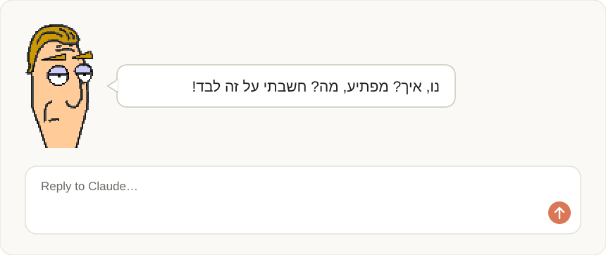
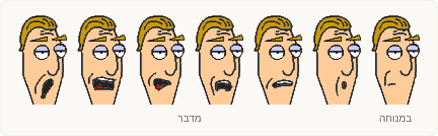
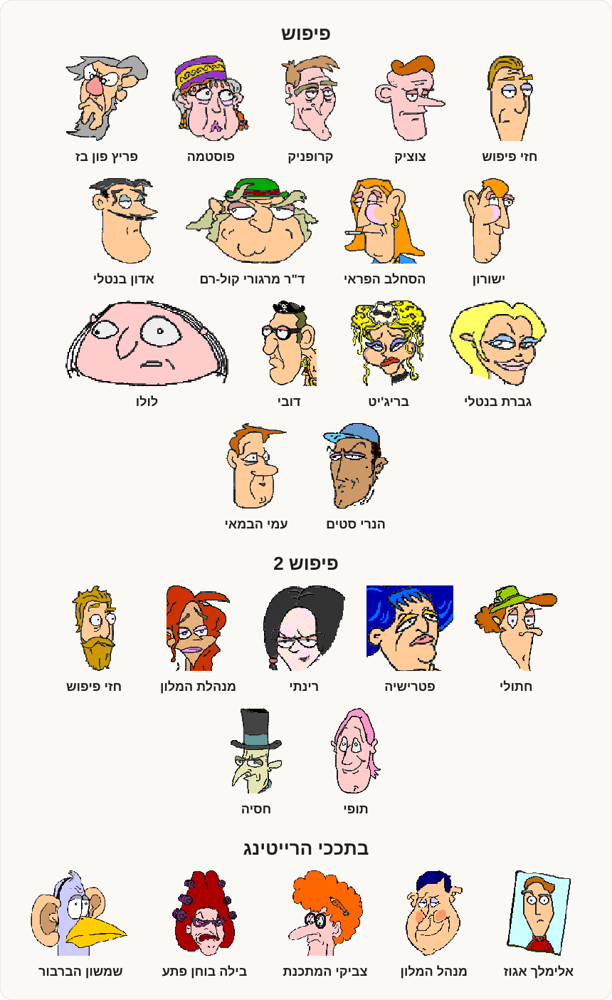

# guillotine-buddy

[](https://github.com/yonatankarp/guillotine-buddy/actions/workflows/ci.yml)
[](LICENSE)
[](https://code.claude.com/docs/en/discover-plugins)

<div dir="rtl">

**החבר'ה מפיפוש, פיפוש 2 ורייטינג עוברים לגור מעל שורת הפקודה של Claude Code.**

בכל שיחה מגיעה דמות אחרת ממשחקי ההרפתקאות של גיליוטינה, באקראי. אחרי כל תור היא אומרת משפט קצר בקול שלה מהמשחק, ומגיבה למה שביקשתם ולמה שנעשה: בדיקות שנכשלו, קומיט, PR. הפה שלה זז כשהיא מדברת, ומדי פעם נכנס גם משפט המחץ שלה. קיבינימט!

</div>

<p align="center"></p>

<div dir="rtl">

## התקנה

צריך את [Claude Code](https://code.claude.com/docs) (בטרמינל, באפליקציית הדסקטופ או בעורך). מקלידים בשורת הפקודה שלו את שתי השורות האלה, אחת אחרי השנייה:

</div>

```
/plugin marketplace add yonatankarp/guillotine-buddy
/plugin install guillotine-buddy@guillotine-buddy
```

<div dir="rtl">

וזהו, הדמות כבר שם. אם מופיעה הודעה על <code dir="ltr">userConfig options not yet set</code>, אפשר להתעלם ממנה: לכל הגדרה יש ברירת מחדל.

## איך משתמשים

לא צריך לעשות כלום: עובדים כרגיל והדמות מגיבה. ואם רוצים לבחור מי מדבר:

| פקודה | מה היא עושה |
| --- | --- |
| <code dir="ltr">/guillotine</code> | מי כאן עכשיו |
| <code dir="ltr">/guillotine next</code> | מישהו אחר, באקראי |
| <code dir="ltr">/guillotine צוציק</code> | דמות לפי שם, בעברית או באנגלית. גם חלק מהשם מספיק |
| <code dir="ltr">/guillotine quiet</code> | הדמות נעלמת ושותקת, גם בשיחות הבאות. עוד פעם, והיא חוזרת |

<p align="center"></p>

## הגדרות

משנים אותן עם:

</div>

```
/plugin configure guillotine-buddy@guillotine-buddy
```

<div dir="rtl">

| הגדרה | ברירת מחדל | מה היא עושה |
| --- | --- | --- |
| <code dir="ltr">language</code> | <code dir="ltr">he</code> | <code dir="ltr">he</code>: עברית, כמו במשחקים. <code dir="ltr">en</code>: אנגלית באותו קול, ומשפטי המחץ נשארים בעברית באותיות לטיניות |
| <code dir="ltr">speechModel</code> | <code dir="ltr">haiku</code> | המודל שכותב את המשפטים של הדמות |

## הדמויות

כל דמות כמו שהיא במשחק שלה: הפרצוף מהמשחק עצמו, והמשפטים תומללו מהקול שלה בו.

</div>

<p align="center"></p>

<div dir="rtl">

## שאלות

**העברית מופיעה הפוכה!**
טרמינלים בלי תמיכה בכתיבה מימין לשמאל הופכים את העברית. באפליקציית הדסקטופ של Claude ובעורכים היא נראית כמו שצריך. בטרמינל כזה אפשר להעביר את <code dir="ltr">language</code> ל-<code dir="ltr">en</code>.

**למה בטרמינל הפרצוף נראה אחרת?**
באפליקציה ובעורכים מופיע האיור המקורי מהמשחק, ברזולוציה שלו. בטרמינל הוא מצויר בחצאי משבצות, ובטרמינל קטן מדי לפרצוף מופיע רק המשפט.

**לא מוצאים את הפקודה <code dir="ltr">/guillotine</code>?**
בחלק מהמקומות Claude Code מציג אותה כ-<code dir="ltr">/guillotine-buddy:guillotine</code>. זו אותה פקודה.

**יש קול?**
לא. הדמות מדברת בבועה, והפה שלה זז.

**מה הדמות רואה?**
בכל תור, המודל שכותב את המשפט מקבל את 300 התווים הראשונים של מה שכתבתם ושל התשובה של Claude, ומה נעשה בתור: כמה פעולות, קומיטים, פושים ו-PRים, ושמות של בדיקות (למשל <code dir="ltr">npm test</code>) ואם עברו או נכשלו. אף פעם לא תוכן של קבצים ולא נתיבים.

**זה רץ גם כשאף אחד לא מסתכל?**
לא. בהרצה בלי ממשק (<code dir="ltr">claude -p</code>, ה-SDK) ובמצב <code dir="ltr">quiet</code> הדמות לא נקראת בכלל.

## קרדיטים

הדמויות, השמות, האיורים והמשפטים שייכים לגיליוטינה (Guillotine), מפיפוש, פיפוש 2 ורייטינג. הפרצופים נחתכו מקבצי המשחקים עצמם, והמשפטים תומללו מקטעי הקול שלהם. זהו פרויקט מעריצים לא רשמי ולא מסחרי: הקוד ברישיון [MIT](LICENSE), והדמויות לא כלולות בו. פרטים ב-[NOTICE](NOTICE).

רוצים לעזור? ראו [CONTRIBUTING.md](CONTRIBUTING.md).

</div>

---

*In English:* a Claude Code plugin that puts a character from Guillotine's Israeli adventure games Piposh, Piposh 2 and Rating above your prompt, reacting to each turn in their own voice. Install with the two commands above; set `language` to `en` for English lines. An unofficial, non-commercial fan project: see [NOTICE](NOTICE).
